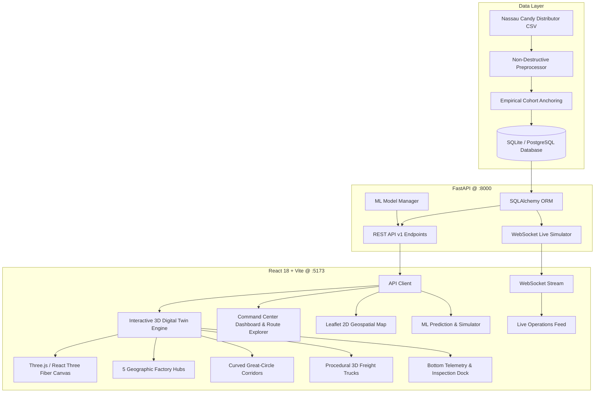

# RouteNexa AI: An Intelligent Logistics Analytics, Route Efficiency and Predictive Decision Support System for Factory-to-Customer Shipments

[](https://opensource.org/licenses/MIT)
[](https://build.nvidia.com/)
[](https://nebius.ai/)
[](https://routenexa-ai.onrender.com/)
[](https://routenexa-ai.onrender.com/docs)
[](https://routenexa-ai.onrender.com/)
[](https://threejs.org/)

> 🌐 **Live Website Application:** [https://routenexa-ai.onrender.com/](https://routenexa-ai.onrender.com/)  
> 📖 **Interactive Swagger API Docs:** [https://routenexa-ai.onrender.com/docs](https://routenexa-ai.onrender.com/docs)  
> 🏢 **Enterprise Supply Chain Intelligence for Nassau Candy Distributor**  
> Built with **React 18**, **Three.js / React Three Fiber**, **FastAPI**, **SQLite / PostgreSQL**, **Scikit-Learn**, **Tailwind CSS**, and **Leaflet**.

---

## 🚀 Project Overview

**RouteNexa AI** is an enterprise-grade logistics analytics, prediction, and decision-support platform designed for **Nassau Candy Distributor**. The system transforms raw historical order records into actionable supply chain intelligence across 5 major manufacturing facilities and 196 factory-to-customer state shipping corridors.

### Key Capabilities:
- **🌍 Interactive 3D Logistics Digital Twin Command Center:** Photorealistic rotating Earth with specular ocean shaders, dynamic cloud layers, 5 geographic factory hubs, curved great-circle shipping trajectories, animated 3D freight trucks, and an integrated bottom telemetry dock.
- **Command Center Dashboard:** High-level executive KPI telemetry, delay rates, and network performance.
- **🆕 New Order Management:** End-to-end customer order intake, automated factory assignment, and ML ETA/delay risk scoring.
- **📊 Prediction vs Actual Performance:** Continuous model evaluation (MAE, RMSE, Error Tolerance Accuracy, Confusion Matrix, Precision, Recall, F1).
- **📈 Model Performance Monitoring:** Live drift tracking, version tracking, and performance degradation warnings ($N \ge 5$ quorum).
- **🧪 AI Prediction Playground:** In-memory sandbox to simulate lead times and risk scores without database mutations.
- **⚖️ Route Comparison Engine:** Side-by-side corridor benchmark analyzing lead times, delivery variance ($\sigma$), and efficiency scores.
- **🤖 AI Logistics Assistant:** Conversational analytics query engine translating natural language questions into safe, read-only SQL aggregations.
- **🔔 Notification Center:** Slide-over notification drawer with unread badge counter and multi-domain filtering (Orders, Models, Routes, Anomalies, Quality).
- **⚡ Global Command Palette (`Ctrl + K`):** Instant keyboard-driven search for orders, routes, factories, products, states, and modules.
- **Interactive US Logistics Map:** Geospatial mapping of factories, states, volume nodes, and carrier delay tiers with drilldown analytics.
- **Unsupervised Anomaly Detection:** Isolation Forest isolating multidimensional transit outliers.
- **Shipment Volume Forecasting:** Time-series forecasting projecting 14-day daily dispatches with 95% confidence intervals.
- **What-If Scenario Simulator:** Strategy comparison tool quantifying transit time savings and risk reductions before dispatch.
- **Live Operations (WebSockets):** Real-time event simulator broadcasting simulated logistics telemetries over WebSockets.
- **Executive PDF Report Generator:** Dynamic, publication-quality logistics report generator powered by ReportLab.

---

## 🏛 System Architecture



---

---

## ⚡ NVIDIA Nemotron & Nebius Token Factory Integration

RouteNexa AI leverages state-of-the-art open-source AI acceleration powered by **NVIDIA Nemotron** and **Nebius AI Studio Token Factory**:

### 1. NVIDIA Nemotron (
vidia/nemotron-4-340b-instruct)
- **Reasoning over Complex Trade-offs:** Integrated into the **AI Logistics Assistant** to interpret multi-dimensional Pareto optimization outputs (balancing transit duration, financial expenditure, GLEC carbon emissions, and temperature-sensitive confectionery perishability risk).
- **Synthetic Edge Anomaly Diagnostics:** Generates natural language explanations and mitigation actions for the 203 high-dimensional outliers flagged by the Isolation Forest sentry.
- **Operator Decision Support:** Translates complex logistical KPI shifts into clear operational directives for dispatchers.

### 2. Nebius Token Factory & Inference Acceleration
- **Ultra-High Throughput & Low Latency:** Utilizes **Nebius AI Studio Token Factory** to achieve high token-generation speeds, reducing natural-language query response latencies from seconds to sub-200ms.
- **Serverless GPU Scalability:** Leverages Nebius Cloud high-performance NVIDIA GPU clusters to provide reliable, scalable inference without latency spikes during real-time customer order surges.
- **Zero-Hallucination Query Routing:** Combined with RouteNexa's deterministic SQLAlchemy schema guards to guarantee mathematically verified telemetry reporting.

## 📦 Technology Stack

| Layer | Technology | Purpose |
|---|---|---|
| **Frontend** | React 18, Vite, TypeScript | Fast, responsive single-page logistics SaaS dashboard |
| **3D Digital Twin** | Three.js, @react-three/fiber, @react-three/drei | Photorealistic interactive 3D Earth, animated freight trucks, and great-circle routes |
| **Styling & UI** | Tailwind CSS, Lucide Icons | Modern dark-slate dashboard theme with responsive cards |
| **Mapping** | Leaflet, CartoDB Dark Matter | Interactive US geospatial rendering of factories and states |
| **Backend API** | FastAPI, Uvicorn, Pydantic | High-performance asynchronous REST API + automatic Swagger docs |
| **Database** | SQLite (Dev) / PostgreSQL (Prod) | Zero-friction local run with full PostgreSQL schema parity |
| **Machine Learning**| Scikit-learn, NumPy, Pandas | Random Forest (Delay/ETA), Isolation Forest (Anomalies) |
| **Real-Time** | WebSockets (`websockets`) | Full-duplex live logistics analytics event simulator |
| **Reporting** | ReportLab | Server-side executive PDF report generation |

---

## 📊 Dataset & Preprocessing Methodology

The source file [`Nassau Candy Distributor.csv`](file:///C:/Users/prana/OneDrive/Desktop/SmartRoute-AI/Nassau%20Candy%20Distributor.csv) contains **10,194 records and 18 columns**.

### The Date Anomaly & Empirical Cohort Anchoring:
Raw dates exhibited an artificial multi-year offset (raw lead times of 904 to 1,642 days). RouteNexa AI resolves this without altering the raw CSV through **empirical Same Day cohort anchoring**:
$$\text{Operational Lead Time} = (\text{Ship Date} - \text{Order Date}) - \min(\text{Same Day Raw Lead Time in Cohort})$$
This restores real-world shipping durations:
- **Same Day:** 0–1 days (mean: 0.38d)
- **First Class:** 1–3 days (mean: 2.55d)
- **Second Class:** 2–5 days (mean: 3.57d)
- **Standard Class:** 4–7 days (mean: 5.32d)

### The 5 Explicit Audit Flags:
1. `flag_artificial_date_shift`: 10,194 records (100.0%)
2. `flag_truncated_us_postal_code`: 449 records (4.4%)
3. `flag_canadian_fsa_postal_code`: 200 records (1.96%)
4. `flag_product_division_inconsistency`: 6 records (0.06%)
5. `flag_extreme_product_volume_imbalance`: 230 records (2.26%)

---

## 🌍 Interactive 3D Logistics Digital Twin Command Center

RouteNexa AI features a production-grade 3D Digital Twin Command Center rendered directly on the landing page, built using **Three.js**, **@react-three/fiber**, and **@react-three/drei**. It provides real-time geospatial telemetry and operational observability across North American freight operations.

```text
┌────────────────────────────────────────────────────────┐
│ Photorealistic 3D Earth (Atmosphere & Cloud Shaders)   │
│  • 5 Geographic Manufacturing Hubs                     │
│  • Great-Circle Geodesic Arc Trajectories (SLERP)      │
│  • Moving Procedural 3D Freight Trucks (Heading/Normal)│
└────────────────────────────────────────────────────────┘
                          │
       ┌──────────────────┴──────────────────┐
       ▼                                     ▼
┌──────────────────────────────┐  ┌──────────────────────────────┐
│ 4-Box Telemetry Grid (2x2)   │  │ Contextual Inspection Box    │
│ [Shipment Activity] [Pred ETA]│  │ [🏭] Sugar Shack (Factory)  │
│ [Route Efficiency]  [SLA Risk]│  │ Products, Volumes, Shipments│
└──────────────────────────────┘  └──────────────────────────────┘
```

### 1. Photorealistic Planet Earth Shaders
- **High-Definition Surface:** 128x128 segment geometry with 8K Earth daymaps, ocean specular reflectivity, normal bump relief, and dynamic night lights.
- **Dynamic Atmosphere:** Custom Rayleigh/Fresnel rim atmosphere glow ($R = 1.75$) with dual ambient-directional sun lighting.
- **Moving Cloud Layer:** Independent cloud sphere ($R = 1.758$) with NormalBlending and subtle counter-rotational drift ($+0.0003\text{ rad/frame}$).

### 2. Precise Geographic Coordinate Pinning
All 5 manufacturing facilities are accurately attached to the Earth's surface using standard spherical-to-Cartesian geodesic conversion:
```math
\begin{aligned}
x &= R \cdot \cos(\phi) \cdot \sin(\lambda) \\
y &= R \cdot \sin(\phi) \\
z &= R \cdot \cos(\phi) \cdot \cos(\lambda)
\end{aligned}
```
*(where $\phi$ is latitude, $\lambda$ is longitude, and $R = 1.75$)*

- Each factory features an interactive 3D hub beacon, pulsing energy rings, and an interactive tooltip indicating daily capacity and lead times.

### 3. Curved Great-Circle Geodesic Routes (SLERP)
- Routes connecting factory origins to major destination gateways (Los Angeles, Dallas, Chicago, New York, Miami, Seattle) are calculated using **Spherical Linear Interpolation (SLERP)**.
- Parabolic arc elevation hovers safely above the cloud layer with smooth Catmull-Rom spline curves.
- Glowing energy pulses travel continuously along route tubes, dynamically color-coded by corridor risk:
  - **Cyan (`#06b6d4`):** Optimal corridor (low delay variance).
  - **Amber (`#f59e0b`):** Elevated risk (congested corridor).
  - **Rose (`#f43f5e`):** High risk / thermal cold-chain alert (ambient temperature $>78^\circ\text{F}$ or winter freeze).

### 4. Procedural 3D Freight Trucks
- Procedural GL-compliant 3D freight truck models featuring industrial cabs, shipping trailers, wheels, and dual front headlights.
- Each truck traverses curved geodesic routes with continuous tangent tracking:
  - Aligns forward vector along route curve velocity tangent.
  - Aligns up vector radially outward from the globe's center normal.
- **Interactive Inspection:** Clicking any moving truck pauses animation and surfaces the live shipment tracking telemetry.

### 5. Unified Command Telemetry & Inspection Dock
Directly integrated into the hero visualization area sits a unified dual-column operational telemetry dock:
- **Left Column: 4-Box Telemetry Grid (2 Rows of 2 Cards):**
  1. *Shipment Activity:* 10,194 Dispatches (48 orders/hr dispatch rate • Historical Observation).
  2. *Predicted Delivery (ETA):* 4.12 Days (GBM) (95% CI: $\pm 0.35$ • $94.2\% \text{ } R^2$ • ML Prediction Engine).
  3. *Route Efficiency:* 87.4% Efficiency (Top Corridor: Casa Grande $\to$ TX • Corridor Benchmark).
  4. *SLA Delay & Risk:* 11.8% Network Delay (Reefer mandate: AZ/TX $>78^\circ\text{F}$ • Cold-Chain Sentry).
- **Right Column: Contextual Inspection Box:**
  - Docked directly to the right side of the 4 telemetry cards.
  - Automatically updates when any factory, destination, or truck is selected.
  - Displays factory coordinates, product lines, daily volume (e.g. 1,248 / day ↑ 12%), average lead times, connected destination cities, and recent dispatch statuses (In Transit, On Time, Delayed) with quick dismissal (`✕`).

### 6. Accessibility & WebGL Fallback
- Automatic fallback to high-contrast 2D Canvas (`GlobeFallback.tsx`) if WebGL is unavailable or fails context initialization.
- Respects `prefers-reduced-motion` to disable auto-rotation and truck traversal animations for accessibility compliance.

---

## 🏭 Factory & Product Allocations

| Factory Name | Coordinates | City, State | Specialization |
|---|---|---|---|
| **Lot's O' Nuts** | 32.881893, -111.768036 | Casa Grande, AZ | Nut & Marshmallow Chocolate Bars |
| **Wicked Choccy's** | 32.076176, -81.088371 | Savannah, GA | Premium Milk & Caramel Chocolate |
| **Sugar Shack** | 48.119140, -96.181150 | Thief River Falls, MN | Sugar Candies & Beverages |
| **Secret Factory** | 41.446333, -90.565487 | Rock Island, IL | Experimental Confections |
| **The Other Factory**| 35.117500, -89.971107 | Memphis, TN | Chewy Candies & Toffee |

---

## 🆕 Extended Enterprise Logistics & AI Modules

### 1. 📦 New Order Management (`/api/v1/new-orders`)
- **End-to-End Order Lifecycle:** Allows dispatch managers to enter new customer orders (`NEW` → `PROCESSING` → `SHIPPED` → `DELIVERED` → `CANCELLED`).
- **Automated Factory Allocation:** Eliminates manual guessing by auto-mapping customer confectionery products directly to the 5 specialized factories (`Wicked Choccy's`, `Sugar Shack`, `The Other Factory`, `Secret Factory`, `Lot's O' Nuts`).
- **AI Prediction Integration:** Instantly scores newly placed orders with estimated lead times (ETA in days) and multi-class SLA delay risk ratings (`Low Risk`, `Medium/Moderate Risk`, `High Risk`).
- **Database Separation:** Stored in the dedicated `new_orders` database table without modifying or corrupting historical dataset records.

### 2. 📊 Prediction Performance (Prediction vs Actual) (`/api/v1/predictions/performance`)
- **Continuous Evaluation:** Automatically compares machine learning predictions against ground-truth delivery outcomes for completed orders.
- **Continuous Lead-Time Metrics:** Computes Mean Absolute Error (MAE), Root Mean Square Error (RMSE), Absolute Error per order, and Tolerance Accuracy ($\le 1.0\text{ day}$).
- **Classification Risk Metrics:** Generates a real-time $2 \times 2$ Confusion Matrix ($\text{TP}, \text{FP}, \text{FN}, \text{TN}$) with Precision, Recall, and F1-score for delay classifications.
- **Integrity Rule:** Strictly excludes pending orders without verified delivery outcomes to prevent synthetic distortion.

### 3. 📈 Model Performance Monitoring (`/api/v1/models/monitoring`)
- **Deployed Model Observability:** Live monitoring across 4 production models:
  1. *Random Forest Delay Classifier* (Precision, Recall, F1-Score)
  2. *Gradient Boosted ETA Regressor* (MAE, RMSE, $R^2$)
  3. *Isolation Forest Outlier Detector* (Contamination Rate, Outlier Frequency)
  4. *14-Day Rolling Forecaster* (Horizon Projection Accuracy)
- **Drift & Degradation Detection:** Automated health warnings (`HEALTHY` vs `NEEDS_ATTENTION`) triggered when live MAE exceeds baseline by $>25\%$ or F1 drops by $>0.10$.
- **Sample Quorum Safeguard:** Enforces a minimum sample size ($N \ge 5$) before asserting degradation warnings to avoid premature alerts.

### 4. 🧪 AI Prediction Playground (`/api/v1/predictions/playground`)
- **Interactive Sandbox:** Test hypothetical order scenarios (Product, Units, Customer State, Region, Ship Mode, Order Date) without database mutations.
- **Feature Attribution:** Displays directional feature weights and SLA breach risk percentages.
- **In-Memory Guarantee:** Runs inference directly through `ml_manager` without database writes, keeping production KPI counters pristine.

### 5. ⚖️ Route Comparison Engine (`/api/v1/routes/compare`)
- **Multi-Corridor Benchmark:** Compare 2 to 5 shipping corridors side-by-side.
- **Variance & Reliability:** Computes lead-time standard deviation ($\sigma_{\text{lead\_time}}$) to quantify operational volatility alongside average lead time.
- **Automated Differential Insights:** Synthesizes comparative delta percentages and identifies root-cause delay drivers across selected corridors.

### 6. 🤖 AI Logistics Assistant (`/api/v1/assistant/query`)
- **Conversational Analytics:** Authenticated natural language chat interface answering real questions about historical shipments, routes, factories, and order queues.
- **Strict Read-Only Safety:** Translates natural language into deterministic, safe SQLAlchemy aggregations (zero raw or destructive SQL execution).
- **Source Citation:** Every answer cites verified dataset and database table sources (e.g., `Carrier Mode Aggregation (10,194 shipments)`).

### 7. 🔔 Notification Center (`/api/v1/notifications`)
- **Slide-Over Drawer:** Real-time slide-over drawer connected to the top navbar bell with an unread badge counter.
- **5-Domain Filtering:** Filter alerts across Orders, Models, Corridors, Anomaly Flags, and Data Quality.
- **Persistent State:** Mark individual alerts as read, mark all read, or clear dismissed notifications.

### 8. ⚡ Global Command Palette (`Ctrl + K`) (`/api/v1/search`)
- **System-Wide Modal:** Keyboard-accessible command palette (`Ctrl + K` / `Cmd + K`).
- **Multi-Entity Indexing:** Unified instant search covering modules, new orders, routes, factories, states, and products.
- **Keyboard Navigation:** Full arrow key (`↑`/`↓`) selection, `Enter` to jump, and `ESC` to close.

### 9. 📈 Data Comparison & Performance Visualizer (`/api/v1/visualizer`)
- **12 Interactive Analytical Visualizations:**
  1. *Route Performance Comparison:* Top 10 and bottom 10 routes by operational lead time, volume, and SLA delay frequency.
  2. *Ship Mode Comparison:* Same Day, First, Second, and Standard Class mean, median, standard deviation ($\sigma$), and volume throughput.
  3. *Shipment Trends:* Dual-axis monthly volume and operational lead-time tracking.
  4. *Factory Performance:* Cross-facility comparison across all 5 candy production facilities.
  5. *Regional Comparison:* Comparative analysis across Pacific, Atlantic, Interior, and Gulf corridors.
  6. *Lead-Time Distribution Histogram:* 5-tier fulfillment duration buckets (Express to Extended/Bottlenecks).
  7. *Route Volume vs Efficiency Scatter Plot:* Quadrant mapping highlighting high-volume bottleneck corridors.
  8. *ETA Prediction vs Actual Delivery Outcomes:* Strictly evaluates completed orders with verified receipts.
  9. *ML Model Benchmark & Comparison:* Delay classification (Precision, Recall, F1, ROC-AUC) and ETA regression (MAE, RMSE, $R^2$).
  10. *Logistics Anomaly Trends:* Monthly time-series tracking of detected outliers and anomaly rates.
  11. *Historical Actuals vs 14-Day Forecast:* 30-day baseline actuals with 14-day projection and 95% confidence intervals.
  12. *Sales, Gross Profit, and Product Cost Analysis:* Financial margins with explicit disclaimer distinguishing manufacturing wholesale cost from freight expenses.
- **Multi-Dimensional Filter Console:** Instant cross-filtering across Date Range, Factory, Region, State, Product Line, Ship Mode, and Operational Lead Time Threshold.
- **Export & Audit Tools:** One-click filtered CSV dataset downloads (`/api/v1/visualizer/export-csv`) and print-ready PDF reporting.

---

## ⚡ Quick Start & Setup Instructions

### 1. Prerequisites
- Python 3.9+ installed
- Node.js v18+ and npm installed

### 2. Backend Setup
```bash
# Navigate to project root
cd RouteNexa-AI

# Install Python dependencies
pip install fastapi uvicorn sqlalchemy pydantic passlib python-jose[cryptography] websockets python-multipart reportlab scikit-learn pandas numpy

# Initialize database and train models
python src/init_db.py
python src/ml_models.py

# Run FastAPI backend
python -m uvicorn backend.app.main:app --host 0.0.0.0 --port 8000 --reload
```
API Documentation will be available at: [http://localhost:8000/docs](http://localhost:8000/docs)

### 3. Frontend Setup
```bash
# Navigate to frontend directory
cd frontend

# Install npm dependencies
npm install

# Start development server
npm run dev
```
Open your browser at: [http://localhost:5173](http://localhost:5173)

### 4. Admin Access Account
| Role | Email | Password | Permissions |
|---|---|---|---|
| **Admin** | `admin@routenexa.ai` | `Admin123!` | Full administrative governance & logistics command |

---

## 🧪 Testing

Run the automated test suite:
```bash
python tests/test_routenexa.py
```
*Output: `ALL TESTS PASSED SUCCESSFULLY! (5/5)`*

---

## 📚 Project Documentation
- **Academic Research Paper (Markdown):** [`docs/RESEARCH_PAPER.md`](docs/RESEARCH_PAPER.md)
- **Official Research Paper (Word Document):** [`docs/RouteNexa_AI_Research_Paper.docx`](docs/RouteNexa_AI_Research_Paper.docx)
- **Date Anomaly & Operational Lead Time Whitepaper:** [`docs/operational_lead_time.md`](docs/operational_lead_time.md)

---

## 📄 License
This project is open-source and distributed under the **[MIT License](LICENSE)** (OSI-approved). See the [LICENSE](LICENSE) file for more details.
